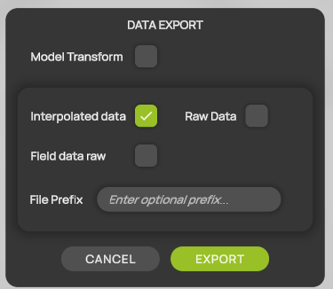

# Data export

Export the measured flow field, the raw measurement points and the models to process them in other tools, for example in [ParaView](../data-processing/working-with-paraview.md).

## Export the data

1. Select  **Export Data** in the [display header](../workspace/display-header.md). The **DATA EXPORT** dialog opens.
2. Select the data you want to export. You can combine several options.
3. Optional: enter a **File Prefix**.
4. Select **EXPORT**.

<figure><figcaption>
DATA EXPORT
</figcaption></figure>

ProCap writes the files to the `Output/Data` folder of the project. See [Project folder structure](../projects/project-folder.md).

## Export options

| Option | What ProCap exports | File |
| --- | --- | --- |
| **Model Transform** | Each model as an STL file, in its current position and orientation in the coordinate system of the measurement. | `<number>_<model name>_transformed.stl` |
| **Interpolated data** | The interpolated flow field of the measurement domain, as an unstructured grid for ParaView. | `MultigridData_<date>_<time>.vtu` |
| **Raw Data** | Every raw measurement point, as a table. | `RawData_<date>_<time>.csv` |
| **Field data raw** | The averaged measurement values in each cell of the domain, without interpolation, as an unstructured grid for ParaView. It uses the same grid as **Interpolated data**, so you can compare the two. | `MultigridData_<date>_<time>_raw.vtu` |
| **File Prefix** | Text that ProCap puts in front of each file name, for example `run3`. Spaces become underscores. Leave it empty to use the default names. | `run3_RawData_<date>_<time>.csv` |

**EXPORT** is available when at least one option is selected. The date and time in the file names are those of the export.

## Export during a replay

If you have loaded recorded data and the time slider is not at the end, the interpolated flow field contains only the data up to the time of the slider. When you export the interpolated data, the field data or replayed models in this state, ProCap asks what to do:

* **EXPORT NOW** exports the data as it is at the current time.
* **JUMP TO END** moves the time slider to the end, interpolates all the data, and returns to the **DATA EXPORT** dialog. Then select **EXPORT** again.

**Raw Data** always contains every measurement point, wherever the time slider is. See [Measurement replay](measurement-replay.md).
