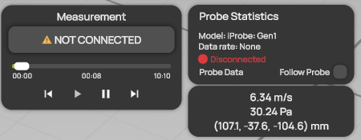

# Measurement replay


**Editions:** All editions.


You can replay any measurement you recorded or [imported](../data-processing/import-measurement-data.md). During a replay, ProCap moves the probe and any tracked models as they moved during the measurement. It builds the flow field up to the current time, so you can watch how the measurement filled the domain.

You control the replay with the time slider and the buttons in the **Measurement** panel. No probe needs to be connected for a replay.

<figure><figcaption>
Replay of a recorded measurement
</figcaption></figure>

## Replay a measurement

1. Record a measurement, or select  **Import Data** in the display header and select recorded data.
2. Select  to play the measurement.
3. Select  to pause at the current time.
4. To go to a specific time, drag the time slider. The replay pauses while you drag.

## Replay controls

| Control | Description |
| --- | --- |
| Time slider | Shows the current time in the measurement. Drag it to go to a time. The green fill shows how far ProCap has built the flow field. |
| Time labels | The start of the measurement, the current time and the total duration, in minutes and seconds. Without data, they show `--:--`. |
|  | Goes back to the start of the measurement and stops the replay. |
|  | Plays the measurement from the current time. |
|  | Pauses the replay. |
|  | Goes to the end of the measurement, so the flow field contains all the data. |

The replay controls are not available while there is no data or while a measurement is running. A button that would do nothing at the current time, for example play at the end of the measurement, is not available either.


When you [export data](data-export.md) and the time slider is not at the end, ProCap asks whether to export the data up to the current time or to jump to the end first.

