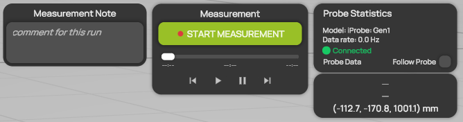
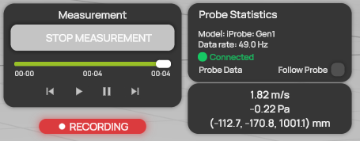
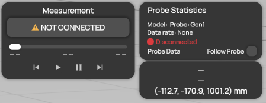

# Recording a measurement


**Editions:** Professional, Compact and Student. Professional Reader is replay-only.


You record a measurement with the **Measurement** panel at the top center of the [workspace](../workspace/README.md). While you record, ProCap collects the probe data and the probe positions and builds the flow field in the measurement domain live.

## Before you start

* Set up the [measurement domain](../scene-setup/measurement-domain-and-interpolation.md), the [models](../scene-setup/models.md) and the [probe](../scene-setup/probe-settings.md).
* Check in the 3D view that the probe and the models are tracked correctly.

## Record a measurement

1. **Connect the probe.** In **Probe Settings**, select **CONNECT**. See [Connecting a probe](connecting-a-probe.md). [Probe statistics](../workspace/probe-statistics.md) shows **Connected**, and the **Measurement** panel shows **START MEASUREMENT**.
2. **Correct the zero offset.** With the flow switched off, select **ZERO OFFSET** in **Probe Settings**. While the probe zeroes, the **Measurement** panel shows **CALIBRATING...**. When it is done, probe statistics shows **Calibrated**.
3. **Describe the run.** Optional: enter a comment in **Measurement Note**, for example the flow speed or the configuration. ProCap saves it with the measurement in the list of measurements. See [Keeping track of the data](keeping-track-of-the-data.md).
4. **Start the measurement.** Switch on the flow, then select **START MEASUREMENT**. The **RECORDING** badge appears below the panel.
5. **Move the probe through the domain.** Watch the flow field build up in the 3D view. Use the [visualization features](../visualization/visualization-features.md) and the [Voxel Eraser](../visualization/voxel-eraser.md) to see where data is still missing.
6. **Stop the measurement.** Select **STOP MEASUREMENT**.

<figure><figcaption>
Probe connected, ready to measure
</figcaption></figure>

<figure><figcaption>
While recording
</figcaption></figure>

ProCap saves each measurement as a `.proCapLog` file in the `Output/Data` folder of the project and adds a line to the list of measurements. See [Project folder structure](../projects/project-folder.md).

## The measurement button

The large button in the **Measurement** panel shows what you can do next.

| Button | Meaning |
| --- | --- |
| **NOT CONNECTED** | No probe is connected. Connect the probe in **Probe Settings**. |
| **CALIBRATING...** | The probe is zeroing its offset. Wait until it is done. |
| **START MEASUREMENT** | The probe is ready. Select it to start recording. |
| **STOP MEASUREMENT** | A measurement is running. Select it to stop recording. |
| **CONTINUE MEASUREMENT** | The project already holds data that was recorded with the same probe. A new measurement adds its data to the existing flow field. |
| **INCOMPATIBLE PROBE** | The project holds data that was recorded with a different probe. If you start a measurement, ProCap asks for confirmation, then clears the current data and starts a new flow field. |

<figure><figcaption>
No probe connected
</figcaption></figure>

## The time slider during a measurement

While you record, the time slider below the button shows the progress of the measurement, and the time labels show the elapsed time. The replay buttons are not available until you stop the measurement. Then you can replay what you recorded. See [Measurement replay](measurement-replay.md).
