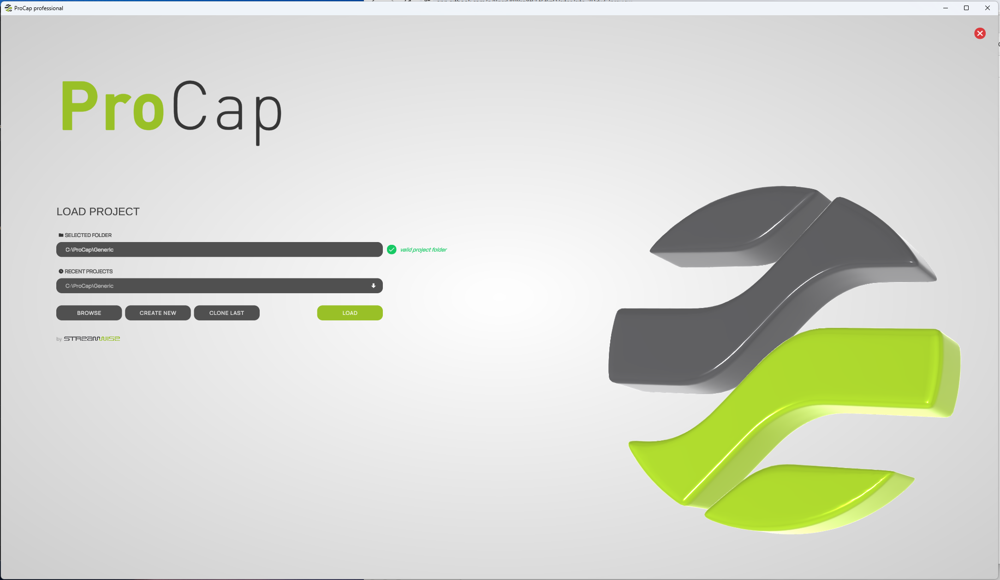
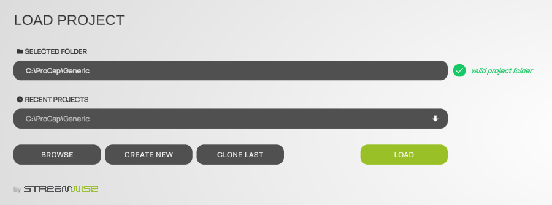

# Start screen

When ProCap starts, it shows the **LOAD PROJECT** start screen. Here you choose the project to work on: a recent project, an existing project folder, a new project or a copy of your last project. The title bar of the window shows your edition, for example **ProCap professional**.

<figure><figcaption>
The start screen
</figcaption></figure>

## Open a project

1. Select the project folder in one of these ways:
   * Select it in **RECENT PROJECTS**.
   * Select **BROWSE** and choose the top-level folder of the project, not its `Input` folder.
   * Type or paste the path into **SELECTED FOLDER**.
2. Check the status next to **SELECTED FOLDER**. See [Folder status](#folder-status).
3. Select **LOAD**.

To start a new project, see [Create and open projects](create-and-open.md).

## Elements of the start screen

<figure><figcaption>
The controls of the start screen
</figcaption></figure>

| Element | Description |
| --- | --- |
| **SELECTED FOLDER** | The project folder that **LOAD** opens. You can type or paste a path. When ProCap starts, it shows your most recent project. |
| **RECENT PROJECTS** | The projects you opened last, most recent first, up to 15. Selecting one puts its folder into **SELECTED FOLDER**. |
| **BROWSE** | Opens a folder dialog to select an existing project folder. |
| **CREATE NEW** | Creates a new project in an empty folder and opens it. ProCap copies the files of a new project into the folder. |
| **CLONE LAST** | Copies your most recent project into an empty folder: its project file, models and other files in the `Input` folder. The `Output` folder of the copy starts empty, so no measurement data is copied. Then select **LOAD** to open the copy. |
| **LOAD** | Opens the project in **SELECTED FOLDER**. |
| Red close button | Closes ProCap. |

For **CREATE NEW** and **CLONE LAST**, select or create an empty folder. If the folder is not empty, ProCap shows a notice and does nothing, so an existing project is never overwritten.

## Folder status

The status next to **SELECTED FOLDER** tells you whether ProCap can open the folder:

| Status | Meaning |
| --- | --- |
| **valid project folder** | The folder contains a ProCap project. **LOAD** opens it. |
| **Folder empty, new config will be set** | The folder is empty. **LOAD** sets up a new project in it and opens it. |
| **invalid project folder path** | The folder is not a ProCap project, or it does not exist. Select the top-level folder of a project, which contains the `Input` and `Output` folders. |

See [Project folder structure](project-folder.md).
