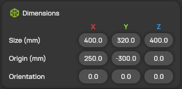
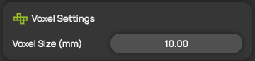
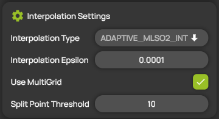
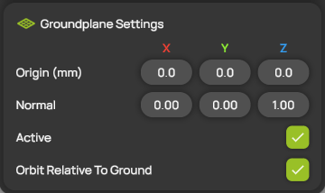

# Measurement domain and interpolation settings

The measurement domain is the box in which ProCap collects measurement points and reconstructs the flow field. ProCap divides the domain into cubic cells, called voxels, and interpolates the measured values onto them. You set the domain, the voxel size, the interpolation and the ground plane in the **Domain Settings** panel.

## Change the settings

1. Open **Domain Settings** from the hotbar.
2. Change the settings you need. They are described in the sections below.
3. Select **SAVE & RELOAD** to apply the changes, or **CANCEL** to discard them.


Changes to the dimensions, the voxel size or the interpolation reload the scene. ProCap asks for confirmation, saves the project, disconnects the probe and reloads. Set up the domain before you start measuring.


## Dimensions

<figure><figcaption>
Dimensions
</figcaption></figure>

| Setting | Description |
| --- | --- |
| **Size (mm)** | The edge lengths of the domain along X, Y and Z. The maximum is 5000 mm per axis. ProCap rounds each size down to a whole number of voxels. Values outside the allowed range are adjusted automatically, and ProCap shows a warning. |
| **Origin (mm)** | The position of the corner of the domain from which it extends along X, Y and Z. The position is given in the [coordinate system](../workspace/coordinate-system.md) of the scene. |
| **Orientation** | The rotation of the domain in degrees about the X, Y and Z axes, applied in that order. The domain rotates about its center, and ProCap updates **Origin (mm)** to match. |

## Voxel Settings

<figure><figcaption>
Voxel Settings
</figcaption></figure>

| Setting | Description |
| --- | --- |
| **Voxel Size (mm)** | The edge length of one voxel. Smaller voxels resolve finer flow structures but need much more memory: halving the voxel size multiplies the number of voxels by eight. The minimum is 2 mm. If the domain needs more memory than the computer has available, ProCap enlarges the voxel size automatically and shows a warning. |


With **Use MultiGrid** switched on, ProCap refines voxels that contain many measurement points down to a half and a quarter of the voxel size. See [Interpolation Settings](#interpolation-settings).


## Interpolation Settings

<figure><figcaption>
Interpolation Settings
</figcaption></figure>

| Setting | Description |
| --- | --- |
| **Interpolation Type** | The method ProCap uses to reconstruct the flow field from the measured points. See the table below. |
| **Interpolation Epsilon** | How closely the field follows the measured values. Lower values follow the measured points more closely, higher values give a smoother field. The range is 0.0001 to 0.9, and the default is 0.01. Only shown for the interpolating types (ending in `_INT`). |
| **Use MultiGrid** | Refines the grid where many measurement points are concentrated. A voxel that contains enough points is split into eight smaller cells, up to two times. If the memory limit is reached, ProCap stops refining and shows a warning. |
| **Split Point Threshold** | The number of measurement points a voxel must contain before it is split. Lower values refine more of the domain. Only has an effect when **Use MultiGrid** is on. |

All interpolation types use moving least squares (MLS): each value is fitted from the measured points around it.

| Interpolation Type | Fit | Use it when |
| --- | --- | --- |
| `ADAPTIVE_MLSO1` | Linear, smoothing | You want a robust result, for example with sparse or noisy data. This is the most economical type. |
| `ADAPTIVE_MLSO2` | Quadratic, smoothing | You have dense data and want to capture curvature in the flow. |
| `ADAPTIVE_MLSO1_INT` | Linear, interpolating | Your data is clean, and the field should pass close to the measured values. |
| `ADAPTIVE_MLSO2_INT` | Quadratic, interpolating | Your data is dense and clean, and you want the highest fidelity. This is the most demanding type. |

## Groundplane Settings

<figure><figcaption>
Groundplane Settings
</figcaption></figure>

| Setting | Description |
| --- | --- |
| **Origin (mm)** | A point that lies on the ground plane. |
| **Normal** | The direction perpendicular to the ground plane. ProCap scales it to length 1 automatically. For example, 0.00, 0.00, 1.00 gives a horizontal plane with Z pointing up. |
| **Active** | Shows or hides the ground plane. |
| **Orbit Relative To Ground** | When on, the camera orbits around the normal of the ground plane. When off, it orbits around the vertical axis of the scene. |
