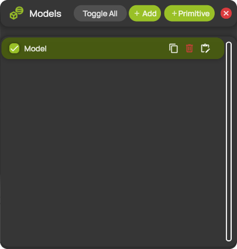
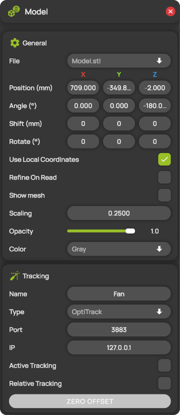

# Model settings

Models are the geometry of your test object, shown in the 3D view together with the measured flow field. ProCap reads them from STL files. You manage the models of a project in the **Models** panel and edit each model in the **Model** panel.

You can add up to 15 models in Professional and Professional Reader, and up to 5 in Compact and Student.

## Add a model from an STL file

1. Copy the `.stl` file into the `Input` folder of the project. See [Project folder structure](../projects/project-folder.md).
2. Open **Models List** from the hotbar. The **Models** panel opens.
3. Select **+ Add**. ProCap adds a new model with a placeholder geometry.
4. Select the new model in the list. The **Model** panel opens.
5. In **File**, select your STL file.
6. Set the position and orientation of the model. See [General](#general).
7. Select **APPLY**.

## Add a primitive

To add a simple shape without an STL file, select **+ Primitive** in the **Models** panel. In the **Add primitive** panel, choose a box, a sphere or a cylinder and enter its dimensions in mm. ProCap creates an STL file for the shape in the `Input` folder and adds it as a new model.

## The Models panel

<figure><figcaption>
The Models panel
</figcaption></figure>

The list shows one row per model, named after its STL file.

| Control | Description |
| --- | --- |
| **Toggle All** | Shows all models. If all models are already shown, hides them all. |
| **+ Add** | Adds a new model. Hidden when your edition's model limit is reached. |
| **+ Primitive** | Opens the **Add primitive** panel. Hidden when your edition's model limit is reached. |
| Check box | Shows or hides the model in the 3D view. |
| Model name | Opens the **Model** panel for this model. |
| Copy icon | Adds a copy of the model. |
| Bin icon | Deletes the model. |
| Edit icon | Opens the **Model** panel for this model. |

## The Model panel

<figure><figcaption>
The Model panel
</figcaption></figure>

The title of the panel shows the name of the model. While the panel is open, ProCap shows your changes on a yellow preview of the model and fades the model itself. You can also move and rotate the preview with the transform gizmo in the 3D view, and the **Position (mm)** and **Angle (°)** fields follow. See [Transform gizmos](../workspace/gizmos.md).

**APPLY** and **CANCEL** appear as soon as you change a setting. **APPLY** applies the changes and keeps the panel open. **CANCEL** discards them. If you close the panel without applying, ProCap discards your changes.

### General

| Setting | Description |
| --- | --- |
| **File** | The STL file of the model. The list shows the `.stl` files in the `Input` folder of the project. |
| **Position (mm)** | The position of the model's origin in the [coordinate system](../workspace/coordinate-system.md) of the scene. |
| **Angle (°)** | The orientation of the model in degrees: first about the X axis, then about the rotated Y axis, then about the rotated Z axis. |
| **Shift (mm)** | Moves the model by the distance you enter. ProCap then sets the fields back to 0. |
| **Rotate (°)** | Rotates the model by the angles you enter. ProCap then sets the fields back to 0. |
| **Use Local Coordinates** | When on, **Shift (mm)**, **Rotate (°)** and the transform gizmo move and rotate the model along its own axes. When off, they use the axes of the scene. This setting applies to all models. |
| **Refine On Read** | Subdivides the triangles of the STL file when ProCap loads it, so that no triangle edge is longer than the voxel size of the [measurement domain](measurement-domain-and-interpolation.md). Use it for STL files with large triangles, for example when you display [projections](../visualization/projections.md) on the model. Loading takes longer. |
| **Show mesh** | Shows the triangles of the model as a wireframe. Available in Professional and Professional Reader. |
| **Scaling** | The scale factor applied to the geometry of the STL file. For example, 0.25 shows the model at a quarter of its size in the file. |
| **Opacity** | The opacity of the model, from 0 (fully transparent) to 1 (opaque). |
| **Color** | The color of the model. |

### Tracking


**Editions:** Professional.


Use tracking for a model that moves during the measurement, for example a model on a turntable or a moving part of the test setup. The tracking system follows a rigid body attached to the model, and ProCap moves the model with it. Recorded model motion is replayed in every edition. See [Measurement replay](../measurement/measurement-replay.md).

| Setting | Description |
| --- | --- |
| **Name** | The name of the rigid body, exactly as it is defined in the tracking software. |
| **Type** | The tracking system that tracks the rigid body. See [Optical tracking systems](../tracking/optitrack.md). |
| **Port** | The network port on which the tracking system streams the rigid body data. 3883 is the default. |
| **IP** | The IP address of the computer that runs the tracking software. Use 127.0.0.1 if it runs on the same computer as ProCap. |
| **Active Tracking** | When on, the model follows the rigid body, and you cannot move it by hand. When you switch it off, the model returns to the position and angle it had before. |
| **Relative Tracking** | When off, ProCap places the origin of the model on the rigid body. When on, the model keeps the offset to the rigid body that you set with **ZERO OFFSET**. |
| **ZERO OFFSET** | Stores the offset between the rigid body and the position and angle you set for the model. From then on, the model moves with the rigid body from there. Available when **Active Tracking** and **Relative Tracking** are applied and no measurement is running. |


Applying changes to **Name**, **Type**, **Port**, **IP** or **Active Tracking** stops a running measurement.


To track a model relative to its rigid body:

1. With **Active Tracking** off, set **Position (mm)** and **Angle (°)** so that the model matches the real object in the scene.
2. Switch on **Active Tracking** and **Relative Tracking**, then select **APPLY**.
3. Make sure the real object is still in the position you set, then select **ZERO OFFSET**.
