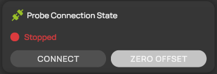
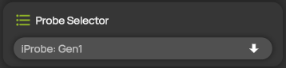
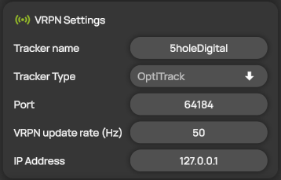
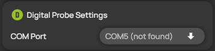
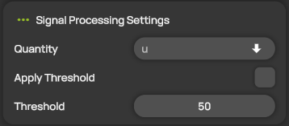

# Probe settings

In the **Probe Settings** panel, you select the probe model, connect the probe, set up how the tracking system tracks it and choose how ProCap filters its data. This page describes the panel for the standard digital probes, the iProbe and the Sphere.


The sections and settings in the panel depend on the probe model you select. Other probe models can show other settings.


## Change the settings

1. Open **Probe Panel** from the hotbar. The **Probe Settings** panel opens.
2. If the probe is connected, select **DISCONNECT**. ProCap locks the settings while the probe is connected.
3. Change the settings you need. They are described in the sections below.
4. Select **APPLY** to apply the changes, or **CANCEL** to discard them. The buttons appear as soon as you change a setting.


Applying probe settings clears the undo history.


## Probe Connection State

<figure><figcaption>
Probe Connection State
</figcaption></figure>

The status line shows the state of the connection to the probe:

| State | Meaning |
| --- | --- |
| **Stopped** | The probe is not connected. |
| **Connecting...** | ProCap is connecting to the probe. |
| **Connected** | The probe is connected and sends data. |
| **Calibrating...** | ProCap is zeroing the offset of the probe. |
| **Calibrated** | The offset is zeroed, and the probe is ready to measure. |

| Button | Description |
| --- | --- |
| **CONNECT** | Connects to the probe. While the probe is connected, the button reads **DISCONNECT** and disconnects it. |
| **ZERO OFFSET** | Zeroes the offset of the probe. Switch off the flow first. Available while the probe is connected and no measurement is running. |

Professional Reader has no live measurement and does not show these buttons.

## Probe Selector

<figure><figcaption>
Probe Selector
</figcaption></figure>

Select the probe model you use, for example **iProbe: Gen1**. The list shows the probe models available in your installation. When you select another model, the panel shows the settings of that model, and **Tracker name** is set to the model's default name if it has one. The 3D geometry of the probe comes with the probe model.

See [Supported probes](../probes/vectoflow-probes.md).

## VRPN Settings

<figure><figcaption>
VRPN Settings
</figcaption></figure>

These settings tell ProCap where to receive the position and orientation of the probe from the tracking system. Professional Reader does not show this section.

| Setting | Description |
| --- | --- |
| **Tracker name** | The name of the probe's rigid body, exactly as it is defined in the tracking software. |
| **Tracker Type** | The tracking system that tracks the probe. In Compact, it is fixed to OptiTrack. See [Optical tracking systems](../tracking/optitrack.md). |
| **Port** | The network port on which the tracking system streams the rigid body data. |
| **VRPN update rate (Hz)** | The rate of the main data collection loop of ProCap, which combines the tracking and probe data. In Compact, it is fixed to 50 Hz. |
| **IP Address** | The IP address of the computer that runs the tracking software. Use 127.0.0.1 if it runs on the same computer as ProCap. |

## Digital Probe Settings

<figure><figcaption>
Digital Probe Settings
</figcaption></figure>

| Setting | Description |
| --- | --- |
| **COM Port** | The serial port the probe is connected to. The list shows the ports available on the computer. If the port saved in the project is not available, it is marked **(not found)**. |

## Signal Processing Settings

<figure><figcaption>
Signal Processing Settings
</figcaption></figure>

Use a threshold to remove single spikes from the probe data before ProCap averages and interpolates it.

| Setting | Description |
| --- | --- |
| **Quantity** | The velocity quantity the threshold applies to. The list shows the velocity quantities of the selected probe model. |
| **Apply Threshold** | Switches the threshold on or off. |
| **Threshold** | The limit in m/s. When the magnitude of **Quantity** reaches this value, ProCap discards the measured values. |


The log file of a measurement keeps the raw data. You can reprocess it with a different threshold when you import it. See [Import of measurement data](../data-processing/import-measurement-data.md).

