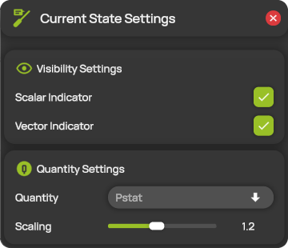

# Current state

The current state shows what the probe measures right now, directly at the probe tip in the 3D view. A colored sphere shows the value of a scalar quantity, and an arrow shows the flow direction. The current state follows the live probe while you measure, and the replayed probe during [measurement replay](../measurement/measurement-replay.md).

If you need the current values as numbers, use the [probe data card](../workspace/probe-data-card.md) in the main workspace.

## Change the settings

1. Open **Current State Settings** from the hotbar.
2. Change the settings you need. ProCap applies them immediately.

To show or hide the whole current state, select **Current state** in the [display header](../workspace/display-header.md). The settings in the panel choose which indicators the current state shows when it is on.

<figure><figcaption>
Current State Settings
</figcaption></figure>

## Visibility Settings

| Setting | Description |
| --- | --- |
| **Scalar Indicator** | Shows a sphere at the probe tip, colored by the value of **Quantity**. The color map adjusts automatically to the range of the values measured so far. |
| **Vector Indicator** | Shows an arrow at the probe tip that points in the flow direction. The arrow always has the same length. It turns red when the probe delivers no valid velocity. Not available in Student, or for data without velocity vectors. |

## Quantity Settings

| Setting | Description |
| --- | --- |
| **Quantity** | The scalar quantity shown by the sphere, for example **Pstat**. The list shows the scalar quantities of the probe. See [Quantities](../measurement/quantities.md). |
| **Scaling** | The size of the sphere and the arrow, from 0.5 to 2 times their default size. |
