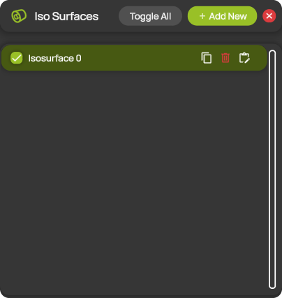
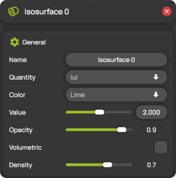

# Isosurfaces


**Editions:** Professional, Professional Reader and Student.


An isosurface connects all points in the measurement domain where a scalar quantity has the same value, for example all points where the velocity magnitude is 2 m/s. Isosurfaces show the shape of flow structures such as wakes and vortices in three dimensions. You manage the isosurfaces in the **Isosurfaces** panel and edit each isosurface in its settings panel.

You can add up to 10 isosurfaces.

## Add and edit an isosurface

1. Open **Isosurfaces** from the hotbar.
2. Select **+ Add New**. ProCap adds a new isosurface to the list.
3. Select the isosurface in the list. Its settings panel opens, with the name of the isosurface as its title.
4. Change the settings you need. ProCap applies them immediately.

You can also select an isosurface by clicking it in the 3D view. The [quick actions](../workspace/gizmos.md#quick-actions) above it let you show or hide, edit, duplicate or delete it.

## The Isosurfaces panel

<figure><figcaption>
The Isosurfaces panel
</figcaption></figure>

| Control | Description |
| --- | --- |
| **Toggle All** | Shows all isosurfaces. If all isosurfaces are already shown, hides them all. |
| **+ Add New** | Adds a new isosurface. Hidden when the limit of 10 isosurfaces is reached. |
| Check box | Shows or hides the isosurface in the 3D view. |
| Isosurface name | Opens the settings panel of the isosurface. |
| Copy icon | Adds a copy of the isosurface. |
| Bin icon | Deletes the isosurface. |
| Edit icon | Opens the settings panel of the isosurface. |

## Isosurface settings

<figure><figcaption>
The settings panel of an isosurface
</figcaption></figure>

| Setting | Description |
| --- | --- |
| **Name** | The name of the isosurface, shown in the list. |
| **Quantity** | The scalar quantity, for example **\|u\|**, the velocity magnitude. See [Quantities](../measurement/quantities.md). |
| **Color** | The color of the isosurface. |
| **Value** | The value of **Quantity** on the isosurface. The slider covers the range of the measured values. You can also type the value in the field. |
| **Opacity** | The opacity of the isosurface, from 0 (fully transparent) to 1 (opaque). |
| **Volumetric** | When on, ProCap draws the whole region where **Quantity** is below **Value** as a translucent volume, instead of only its surface. |
| **Density** | How dense the volume appears with **Volumetric** on, from 0 to 1. The volume is clear at the isosurface and becomes denser where the values are further below **Value**. |
