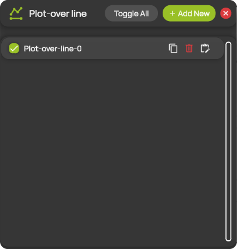
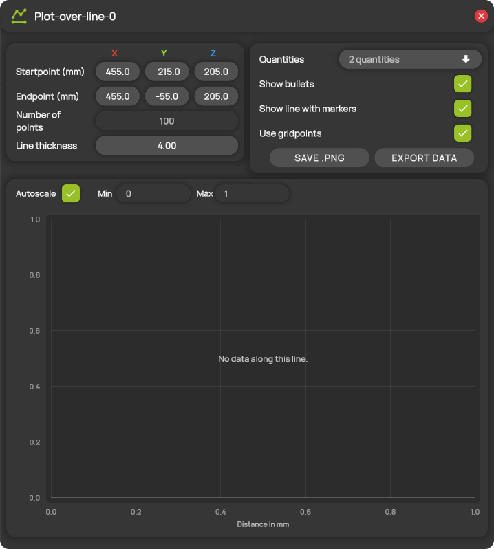

# Plot-over line


**Editions:** Professional, Professional Reader and Student.


A plot-over line is a straight line through the measurement domain. ProCap samples the flow field along the line and plots the selected quantities against the distance from the start point, for example to show a velocity profile through a wake. You manage the lines in the **Plot-over line** panel. Each line has its own window with its settings and its plot.

You can add up to 10 lines.

## Add and edit a line

1. Open **Plot-over line** from the hotbar.
2. Select **+ Add New**. ProCap adds a new line to the list and opens its window.
3. Set the start point and the end point of the line, either in the window or with the gizmos in the 3D view.
4. Select the quantities to plot and change the other settings you need. ProCap applies them immediately.

The window of a line opens when you show the line and closes when you hide it. You can also open it with the edit icon in the list, or by clicking the line in the 3D view.

## The Plot-over line panel

<figure><figcaption>
The Plot-over line panel
</figcaption></figure>

| Control | Description |
| --- | --- |
| **Toggle All** | Shows all lines. If all lines are already shown, hides them all. |
| **+ Add New** | Adds a new line. Hidden when the limit of 10 lines is reached. |
| Check box | Shows or hides the line in the 3D view, and opens or closes its window. |
| Line name | Opens the window of the line. |
| Copy icon | Adds a copy of the line. |
| Bin icon | Deletes the line. |
| Edit icon | Opens the window of the line. |

## The plot window

<figure><figcaption>
The window of a plot-over line
</figcaption></figure>

The title of the window shows the name of the line. The settings are at the top, and the plot is below them.

### Line settings

| Setting | Description |
| --- | --- |
| **Startpoint (mm)** | The position of the start of the line, in the [coordinate system](../workspace/coordinate-system.md) of the scene. The distance in the plot is measured from this point. |
| **Endpoint (mm)** | The position of the end of the line. |
| **Number of points** | The number of points, evenly spaced along the line, at which ProCap samples the flow field, from 2 to 4096. Only available with **Use gridpoints** off. |
| **Line thickness** | The thickness of the curves in the plot, from 0.25 to 20. |
| **Quantities** | The quantities to plot. Open the list and select one or more quantities. Each quantity has its own color. |
| **Show bullets** | Marks each sample point in the plot with a dot. |
| **Show line with markers** | Shows the line in the 3D view. A selected line is always shown. |
| **Use gridpoints** | When on, ProCap samples the flow field where the line crosses the cells of the grid, so the sample points follow the resolution of the grid. When off, it uses **Number of points**. |
| **SAVE .PNG** | Saves the plot as an image. |
| **EXPORT DATA** | Saves the plotted values as a CSV file, with one column for the distance in mm and one column per quantity. |

ProCap saves both files in the `Output/1Dplots` folder of the project. The file name contains the name of the line, the date and time, and the plotted quantities, so an export never overwrites an earlier one. See [Project folder structure](../projects/project-folder.md).

### Plot

| Setting | Description |
| --- | --- |
| **Autoscale** | Sets the range of the vertical axis automatically from the plotted values. |
| **Min** / **Max** | The range of the vertical axis while **Autoscale** is off. Max must be greater than Min. |

The horizontal axis shows the distance from the start point in mm. Below the plot, a legend shows the color of each quantity. To read exact values, point at a curve: ProCap shows the values at that point.

The plot shows **No data along this line.** when there are no measured values along the line. This is the case at the start of a measurement, before any data is available, and when the line lies outside the measured data.

## The line in the 3D view

Click a line in the 3D view to select it and open its window. Like a [rake](streamlines.md#the-rake-in-the-3d-view), a selected line has three gizmos: one at each end to move that end, and one in the middle to move the whole line. **Startpoint (mm)** and **Endpoint (mm)** follow your changes. The [quick actions](../workspace/gizmos.md#quick-actions) above the line let you show or hide, edit, duplicate or delete it.
