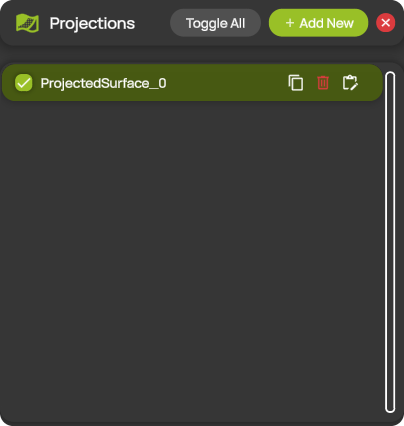
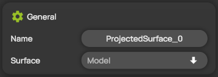
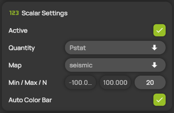
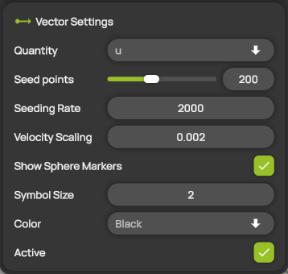
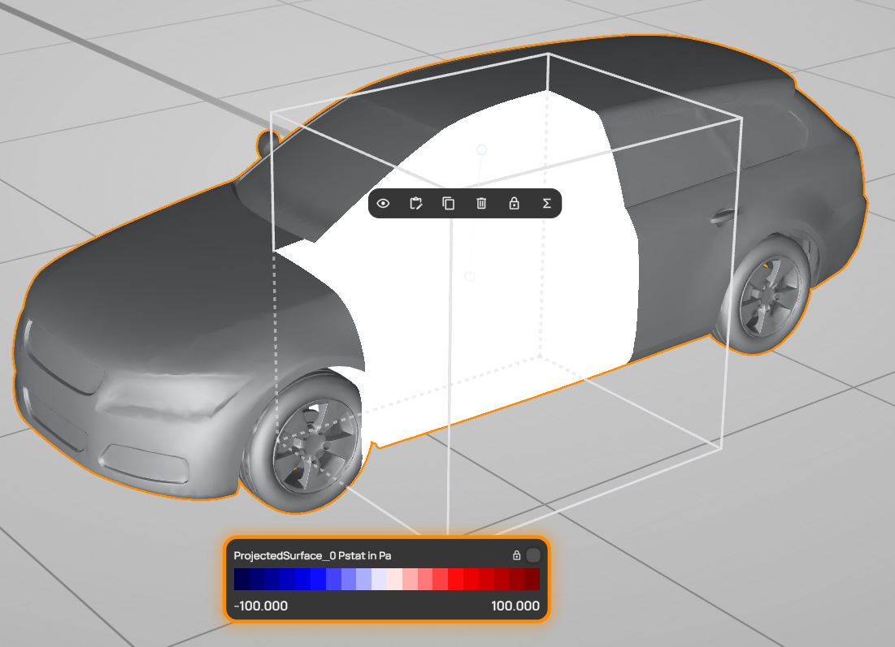

# Projections


**Editions:** Professional, Professional Reader and Student. Student shows scalar quantities only, without surface streamlines.


A projection paints the measured flow field onto the surface of a model. It can color the surface by a scalar quantity, for example the static pressure, and show animated streamlines along the surface. ProCap draws the projection only on the parts of the model that lie inside the measurement domain. You manage the projections in the **Projections** panel and edit each projection in its settings panel.

You can add up to 5 projections. You need at least one [model](../scene-setup/models.md) in the scene to add a projection.

## Add and edit a projection

1. Open **Projections** from the hotbar.
2. Select **+ Add New**. ProCap adds a new projection to the list.
3. Select the projection in the list. Its settings panel opens, with the name of the projection as its title.
4. In **Surface**, select the model to project onto.
5. Change the other settings you need. ProCap applies them immediately.

You can also select a projection by clicking it on the model in the 3D view. See [The projection in the 3D view](#the-projection-in-the-3d-view).

## The Projections panel

<figure><figcaption>
The Projections panel
</figcaption></figure>

| Control | Description |
| --- | --- |
| **Toggle All** | Shows all projections. If all projections are already shown, hides them all. |
| **+ Add New** | Adds a new projection. Hidden when the limit of 5 projections is reached or when the scene has no model. |
| Check box | Shows or hides the projection in the 3D view. |
| Projection name | Opens the settings panel of the projection. |
| Copy icon | Adds a copy of the projection. |
| Bin icon | Deletes the projection. |
| Edit icon | Opens the settings panel of the projection. |

## General

<figure><figcaption>
General
</figcaption></figure>

| Setting | Description |
| --- | --- |
| **Name** | The name of the projection, shown in the list and in the legend. |
| **Surface** | The model the projection is painted on. The list shows the models of the scene. |

## Scalar Settings

<figure><figcaption>
Scalar Settings
</figcaption></figure>

| Setting | Description |
| --- | --- |
| **Active** | Colors the model surface by the scalar quantity. |
| **Quantity** | The scalar quantity shown on the surface, for example **Pstat**, the static pressure. See [Quantities](../measurement/quantities.md). |
| **Map** | The color map, for example **seismic**. |
| **Min / Max / N** | The lowest and highest value of the color map, and the number of color levels. Min must be smaller than Max. |
| **Auto Color Bar** | Sets Min and Max automatically from the range of the measured values. While it is on, you cannot edit Min and Max. |

## Vector Settings


**Editions:** Professional and Professional Reader.


<figure><figcaption>
Vector Settings
</figcaption></figure>

The vector settings show surface streamlines: ProCap traces streamlines of the flow along the model surface, starting from seed points spread at random over the surface inside the measurement domain. Particles move along the streamlines to show the flow direction.

| Setting | Description |
| --- | --- |
| **Quantity** | The vector quantity, for example **u**, the velocity. |
| **Seed points** | The number of streamlines, from 10 to 500. The default is 200. |
| **Seeding Rate** | How often a new particle starts along each streamline. Higher values place the particles closer together. |
| **Velocity Scaling** | How fast the particles move along the streamlines. |
| **Show Sphere Markers** | Shows the moving particles as spheres. When off, only the streamlines are drawn. |
| **Symbol Size** | The size of the particles. |
| **Color** | The color of the streamlines. |
| **Active** | Shows the surface streamlines. |

## The projection in the 3D view

<figure><figcaption>
A selected projection in the 3D view
</figcaption></figure>

Select a projection by clicking it on the model in the 3D view. A selected projection shows the following:

* **Orange outline.** The outline around the model shows that the projection is selected. When you point at a projection without selecting it, its outline is light blue. A projection has no transform gizmo: it always follows its model.
* **Quick actions.** A small bar above the projection to show or hide, edit, duplicate or delete the projection, and to lock its legend on the screen. The **Σ** icon opens the [surface analytics](surface-analytics.md) of the model, or creates one if the model has none yet. See [Quick actions](../workspace/gizmos.md#quick-actions).
* **Legend.** See below.

### The legend

The legend at the bottom of the 3D view shows the color map of the projection: the name of the projection, the quantity and its unit, the color levels and the values of Min and Max. Its frame has the same color as the outline of the projection, so you can tell which legend belongs to which projection.

The legend of a selected projection appears automatically. To keep it on the screen after you select something else, lock it with the lock on the legend or the lock in the quick actions. Locked legends of several projections or planes appear side by side, so you can compare them.
