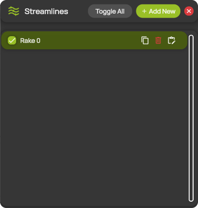
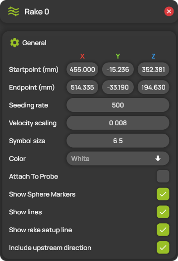
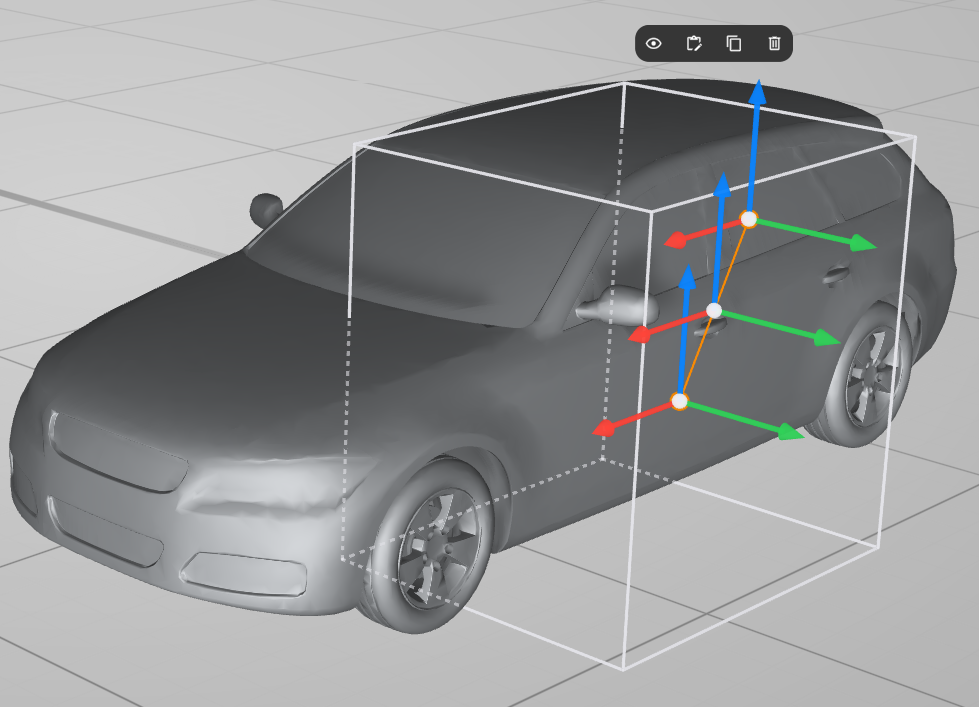

# Streamlines


**Editions:** Professional and Professional Reader.


Streamlines show the paths the flow takes through the measurement domain. ProCap starts them from a rake: a straight line with 11 seed points spread evenly between its start point and its end point. From each seed point, ProCap traces a streamline through the reconstructed flow field. Particles move along the streamlines to show the flow direction and speed. You manage the rakes in the **Streamlines** panel and edit each rake in its settings panel.

You can add up to 10 rakes.

## Add and edit a rake

1. Open **Streamlines** from the hotbar.
2. Select **+ Add New**. ProCap adds a new rake to the list.
3. Select the rake in the list. Its settings panel opens, with the name of the rake as its title.
4. Set the start point and the end point of the rake, either in the panel or with the gizmos in the 3D view. See [The rake in the 3D view](#the-rake-in-the-3d-view).
5. Change the other settings you need. ProCap applies them immediately.

## The Streamlines panel

<figure><figcaption>
The Streamlines panel
</figcaption></figure>

| Control | Description |
| --- | --- |
| **Toggle All** | Shows all rakes. If all rakes are already shown, hides them all. |
| **+ Add New** | Adds a new rake. Hidden when the limit of 10 rakes is reached. |
| Check box | Shows or hides the rake and its streamlines in the 3D view. |
| Rake name | Opens the settings panel of the rake. |
| Copy icon | Adds a copy of the rake. |
| Bin icon | Deletes the rake. |
| Edit icon | Opens the settings panel of the rake. |

## Rake settings

<figure><figcaption>
The settings panel of a rake
</figcaption></figure>

| Setting | Description |
| --- | --- |
| **Startpoint (mm)** | The position of one end of the rake, in the [coordinate system](../workspace/coordinate-system.md) of the scene. |
| **Endpoint (mm)** | The position of the other end of the rake. |
| **Seeding rate** | How often a new particle starts along each streamline. Higher values place the particles closer together. The maximum is 3000. |
| **Velocity scaling** | How fast the particles move along the streamlines. |
| **Symbol size** | The size of the particles. |
| **Color** | The color of the streamlines and particles. |
| **Attach To Probe** | Moves the rake with the probe tip. While the rake is attached, it has no gizmos. When you switch it off, the rake returns to its previous position. This setting is not saved with the project. Available in Professional and Professional Reader. |
| **Show Sphere Markers** | Shows the moving particles as spheres. |
| **Show lines** | Shows the streamlines as lines. |
| **Show rake setup line** | Shows the straight line between the start point and the end point of the rake. |
| **Include upstream direction** | When on, ProCap traces each streamline both downstream and upstream of its seed point. When off, it traces only downstream. |

## The rake in the 3D view

<figure><figcaption>
A selected rake in the 3D view
</figcaption></figure>

Select a rake by clicking its setup line in the 3D view. A selected rake, or the rake whose settings panel is open, shows the following:

* **Orange setup line.** The setup line of the selected rake is orange, as the outline of a selected plane is.
* **Gizmos.** A rake has three gizmos: one at the start point, one at the end point and one in the middle. Each gizmo has three arrows along the axes of the scene: red for X, green for Y and blue for Z. Drag an arrow at an end to move that end of the rake. Drag an arrow in the middle to move the whole rake. **Startpoint (mm)** and **Endpoint (mm)** follow your changes. See [Transform gizmos](../workspace/gizmos.md).
* **Quick actions.** A small bar above the rake to show or hide, edit, duplicate or delete the rake. See [Quick actions](../workspace/gizmos.md#quick-actions).
