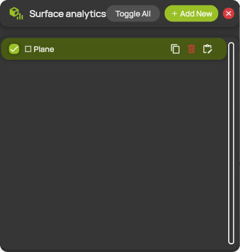
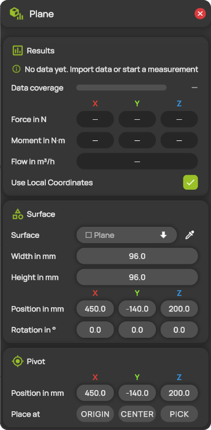
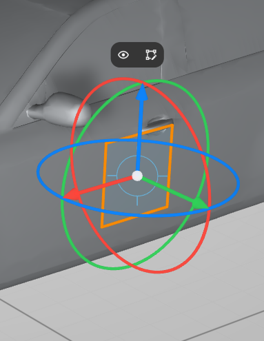
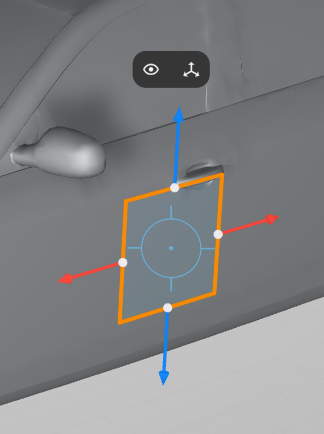

# Surface analytics


**Editions:** Professional, Professional Reader and Student.


Surface analytics integrates the measured flow field over a surface. It reports the static-pressure force on the surface, the moment of that force about a pivot and the volume flow through the surface. The surface can be a simple shape (a plane or an ellipse) or a model. You manage the analyses in the **Surface analytics** panel. Each analysis has its own window with its results and settings.

You can add up to 10 analyses.

## Simple shapes and models

| | Plane or ellipse | Model |
| --- | --- | --- |
| **Surface** | A flat, open sheet that you place anywhere in the measurement domain and size with **Width in mm** and **Height in mm**. | The surface of a model in the scene. The analysis follows the model when it moves. |
| **Typical use** | A control surface in the flow, for example across a jet or an outlet, to measure the volume flow through it. | The loads on a test object, for example the pressure force and moment on a vehicle. |
| **Volume flow** | The flow through the sheet. Positive values mean flow against the normal of the sheet. ProCap shows an arrow for the flow in the 3D view. | The net flow into the closed model. It should be close to zero; any remainder comes from measurement uncertainty. No flow arrow is shown. |
| **Editing in the 3D view** | Move, rotate and resize the sheet with its gizmos. See [The analysis in the 3D view](#the-analysis-in-the-3d-view). | Move the model in the [Model settings](../scene-setup/models.md). |

To analyze a closed simple shape, such as a box, a sphere or a cylinder, add it as a model with **+ Primitive** in the [Models panel](../scene-setup/models.md#add-a-primitive), then analyze that model.


The force is the static-pressure force relative to the ambient pressure, the average of **Pstat** over the whole measurement. It contains no skin friction.


## Add and edit an analysis

1. Open **Surface analytics** from the hotbar.
2. Select **+ Add New**. ProCap adds a new analysis on a plane and opens its window.
3. In **Surface**, keep the plane, select the ellipse or select a model.
4. Place the surface and the pivot. ProCap applies all changes immediately and updates the results.

You can also start an analysis of a model directly in the 3D view: select the model or a projection on it and select **Σ** in its [quick actions](../workspace/gizmos.md#quick-actions). ProCap opens the model's analysis, or creates one if the model has none yet.

## The Surface analytics panel

<figure><figcaption>
The Surface analytics panel
</figcaption></figure>

| Control | Description |
| --- | --- |
| **Toggle All** | Switches all analyses on. If all analyses are already on, switches them all off. |
| **+ Add New** | Adds a new analysis on a plane. Hidden when the limit of 10 analyses is reached. |
| Check box | Switches the analysis on or off. Switching it on shows its surface and opens its window. Switching it off closes the window. |
| Analysis name | Opens the window of the analysis. |
| Copy icon | Adds a copy of the analysis. |
| Bin icon | Deletes the analysis. Deleting the analysis of a model leaves the model in the scene. |
| Edit icon | Opens the window of the analysis. |

## The analysis window

<figure><figcaption>
The window of a surface analysis
</figcaption></figure>

The title of the window shows the name of the surface. Closing the window does not switch the analysis off: its surface and results stay in the 3D view.

### Results

The status line at the top of the section explains when the values cannot be shown or are incomplete, for example **No data yet. Import data or start a measurement** or when the surface lies outside the measurement domain.

| Setting | Description |
| --- | --- |
| **Data coverage** | The share of the surface area that has measured data under it. The bar is green from 95%, amber below that and red below 80%. ProCap integrates only the parts of the surface with data. While the window is open, the parts without data are hatched in the 3D view. |
| **Force in N** | The static-pressure force on the surface, in X, Y and Z. |
| **Moment in N·m** | The moment of the force about the pivot, in X, Y and Z. |
| **Flow in m³/h** | The volume flow through the surface. |
| **Use Local Coordinates** | When on, ProCap gives the force and moment components along the axes of the surface. When off, it uses the axes of the scene. The arrows of the gizmos follow the same axes. |

When the surface has no data at all, the fields show a dash instead of zeros.

### Surface

| Setting | Description |
| --- | --- |
| **Surface** | The surface to analyze: a plane, an ellipse or one of the models in the scene. With the eyedropper next to the list, you can click a model in the 3D view instead. Press Esc to cancel. |
| **Width in mm** / **Height in mm** | The size of the plane or ellipse. |
| **Position in mm** | The position of the center of the plane or ellipse, in the [coordinate system](../workspace/coordinate-system.md) of the scene. |
| **Rotation in °** | The orientation of the plane or ellipse. |

For a model, the section shows only **Surface**: the model's position and orientation come from the [Model settings](../scene-setup/models.md).

### Pivot

The pivot is the reference point for the moment.

| Setting | Description |
| --- | --- |
| **Position in mm** | The position of the pivot, in the coordinate system of the scene. |
| **Place at** | Moves the pivot: **ORIGIN** to the origin of the surface, **CENTER** to its center of area, or **PICK** to a point you click on the surface in the 3D view. Press Esc to cancel a pick. |

## The analysis in the 3D view

ProCap draws the surface of every analysis that is switched on. At the pivot, it shows the force as an arrow and the moment as a curved arrow, each with its value. A plane or ellipse also gets an arrow for the flow through it. The arrows keep the same size on the screen and show directions; the values are in the labels and in the window.

The pivot is shown as a target icon. Click it to move the pivot with a gizmo that has three arrows.

Click the edge of a plane or ellipse to select it. The selected sheet has an orange outline and shows one of two gizmos. Switch between them with the second icon in the quick actions. The first icon shows or hides the analysis.

<figure><figcaption>
Move and rotate gizmo
</figcaption></figure>

**Move and rotate gizmo.** Drag an arrow to move the sheet along that axis, and drag a ring to rotate it about that axis: red for X, green for Y and blue for Z. **Position in mm** and **Rotation in °** follow your changes. Every selection starts with this gizmo.

<figure><figcaption>
Resize arrows
</figcaption></figure>

**Resize arrows.** One arrow sits on each side of the sheet. Drag an arrow to move that side in or out; the opposite side stays where it is. **Width in mm** and **Height in mm** follow your changes.

See also [Transform gizmos](../workspace/gizmos.md).
