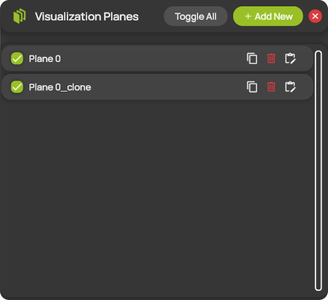
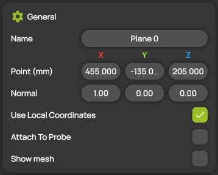
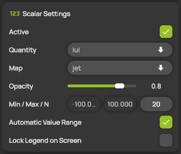
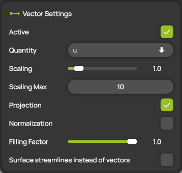
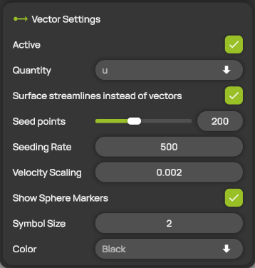
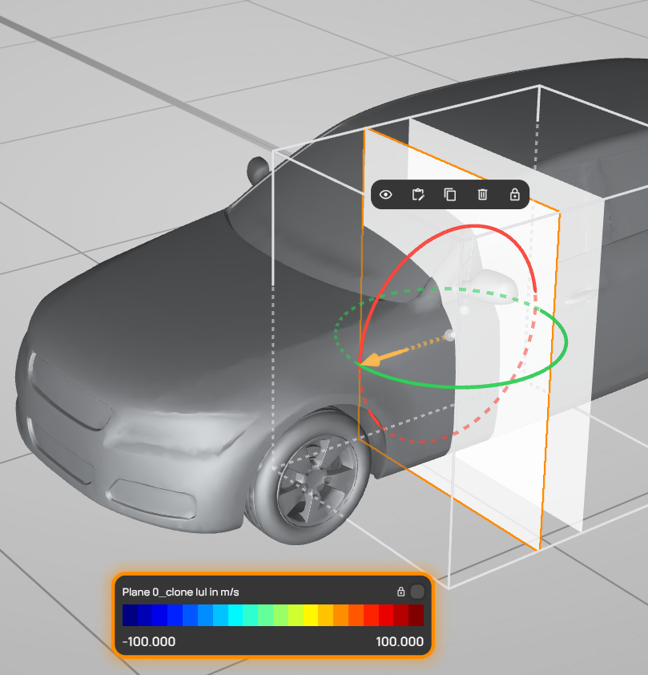

# Visualization planes

A visualization plane cuts through the measurement domain and shows the flow field on the cut. It can color the plane by a scalar quantity, draw velocity vectors on it or show animated streamlines in the plane. You manage the planes in the **Visualization Planes** panel and edit each plane in its settings panel.

You can add up to 10 planes in Professional, Professional Reader and Student, and up to 5 in Compact.

## Add and edit a plane

1. Open **Visualization Planes** from the hotbar.
2. Select **+ Add New**. ProCap adds a new plane to the list.
3. Select the plane in the list. Its settings panel opens, with the name of the plane as its title.
4. Change the settings you need. ProCap applies them immediately.

You can also select a plane directly in the 3D view. See [The plane in the 3D view](#the-plane-in-the-3d-view).

## The Visualization Planes panel

<figure><figcaption>
The Visualization Planes panel
</figcaption></figure>

| Control | Description |
| --- | --- |
| **Toggle All** | Shows all planes. If all planes are already shown, hides them all. |
| **+ Add New** | Adds a new plane. Hidden when your edition's plane limit is reached. |
| Check box | Shows or hides the plane in the 3D view. |
| Plane name | Opens the settings panel of the plane. |
| Copy icon | Adds a copy of the plane. |
| Bin icon | Deletes the plane. |
| Edit icon | Opens the settings panel of the plane. |

## General

<figure><figcaption>
General
</figcaption></figure>

| Setting | Description |
| --- | --- |
| **Name** | The name of the plane, shown in the list and in the legend. |
| **Point (mm)** | A point that lies on the plane, in the [coordinate system](../workspace/coordinate-system.md) of the scene. |
| **Normal** | The direction perpendicular to the plane. ProCap scales it to length 1 automatically. For example, 1.00, 0.00, 0.00 gives a plane perpendicular to the X axis. |
| **Use Local Coordinates** | Switches the transform gizmo of the plane between its local layout, aligned with the plane, and the layout aligned with the scene axes. This setting applies to all planes. See [The plane in the 3D view](#the-plane-in-the-3d-view). |
| **Attach To Probe** | Moves the plane with the probe tip. Only one plane can be attached to the probe at a time, and an attached plane has no gizmo. Available in Professional and Professional Reader. |
| **Show mesh** | Shows the cells of the plane as a wireframe. Available in Professional and Professional Reader. |

## Scalar Settings

<figure><figcaption>
Scalar Settings
</figcaption></figure>

| Setting | Description |
| --- | --- |
| **Active** | Colors the plane by the scalar quantity. |
| **Quantity** | The scalar quantity shown on the plane, for example **\|u\|**, the velocity magnitude. See [Quantities](../measurement/quantities.md). |
| **Map** | The color map, for example **jet**. |
| **Opacity** | The opacity of the colored plane, from 0 (fully transparent) to 1 (opaque). |
| **Min / Max / N** | The lowest and highest value of the color map, and the number of color levels. Min must be smaller than Max. |
| **Automatic Value Range** | Sets Min and Max automatically from the range of the measured values. While it is on, you cannot edit Min and Max. |
| **Lock Legend on Screen** | Keeps the legend of the plane on the screen, even when the plane is not selected. See [The legend](#the-legend). |

## Vector Settings


**Editions:** Professional, Compact and Professional Reader.


<figure><figcaption>
Vector Settings
</figcaption></figure>

| Setting | Description |
| --- | --- |
| **Active** | Draws velocity vectors on the plane. |
| **Quantity** | The vector quantity, for example **u**, the velocity. |
| **Scaling** | The length of the arrows. |
| **Scaling Max** | The upper end of the **Scaling** slider. Increase it if you need longer arrows. |
| **Projection** | When on, ProCap projects the vectors onto the plane, so the arrows show only the in-plane component of the flow. When off, the arrows show the full vectors. |
| **Normalization** | When on, all arrows have the same length and show only the flow direction. |
| **Filling Factor** | The density of the arrows, from 0 to 1. At 1, ProCap draws one arrow per cell of the plane; lower values leave cells out. Where the [MultiGrid](../scene-setup/measurement-domain-and-interpolation.md#interpolation-settings) has refined the grid, the cells are smaller and the arrows denser. |
| **Surface streamlines instead of vectors** | Shows animated streamlines in the plane instead of arrows. See [Surface streamlines](#surface-streamlines). |

### Surface streamlines


**Editions:** Professional and Professional Reader.


<figure><figcaption>
Vector Settings with surface streamlines
</figcaption></figure>

With **Surface streamlines instead of vectors** switched on, ProCap traces streamlines of the in-plane flow, starting from seed points spread at random over the plane. Particles move along the streamlines to show the flow direction. The vector settings change to the following:

| Setting | Description |
| --- | --- |
| **Seed points** | The number of streamlines, from 10 to 500. The default is 200. |
| **Seeding Rate** | How often a new particle starts along each streamline. Higher values place the particles closer together. |
| **Velocity Scaling** | How fast the particles move along the streamlines. |
| **Show Sphere Markers** | Shows the particles as spheres. |
| **Symbol Size** | The size of the particles. |
| **Color** | The color of the streamlines. |

## The plane in the 3D view

<figure><figcaption>
A selected plane in the 3D view
</figcaption></figure>

Select a plane by clicking it in the 3D view. A selected plane shows the following:

* **Orange frame.** The outline of the selected plane. When you point at a plane without selecting it, its outline is light blue.
* **Transform gizmo.** With **Use Local Coordinates** on, the gizmo has an arrow along the normal of the plane and two rings. Drag the arrow to move the plane along its normal, and drag a ring to tilt the plane. With **Use Local Coordinates** off, the gizmo has arrows and rings along the axes of the scene, plus an arrow that shows the normal. **Point (mm)** and **Normal** follow your changes. See [Transform gizmos](../workspace/gizmos.md).
* **Quick actions.** A small bar above the plane to show or hide, edit, duplicate or delete the plane, and to lock its legend on the screen. See [Quick actions](../workspace/gizmos.md#quick-actions).
* **Legend.** See below.

### The legend

The legend at the bottom of the 3D view shows the color map of the plane: the name of the plane, the quantity and its unit, the color levels and the values of Min and Max. Its frame has the same color as the outline of the plane, so you can tell which legend belongs to which plane.

The legend of a selected plane appears automatically. To keep it on the screen after you select something else, lock it with the lock on the legend, the lock in the quick actions or **Lock Legend on Screen**. Locked legends of several planes appear side by side, so you can compare them.
