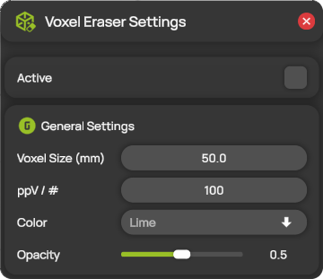

# Voxel Eraser


**Editions:** Professional and Professional Reader.


The Voxel Eraser shows where you still need to measure. It divides the measurement domain into large cubes and fills them with translucent color. ProCap counts the measurement points in each cube. As soon as a cube contains enough points, it disappears, as if you had erased it with the probe. The cubes that remain show the regions without enough data.

The Voxel Eraser follows a live measurement and a [measurement replay](../measurement/measurement-replay.md). During a replay, it shows the state at the current replay time.

## Change the settings

1. Open **Voxel Eraser** from the hotbar. The **Voxel Eraser Settings** panel opens.
2. Switch **Active** on to show the Voxel Eraser. This takes effect immediately.
3. Change the general settings, then select **APPLY**, or **CANCEL** to discard the changes. The buttons appear as soon as you change a setting.

<figure><figcaption>
Voxel Eraser Settings
</figcaption></figure>

| Setting | Description |
| --- | --- |
| **Active** | Shows or hides the Voxel Eraser in the 3D view. |
| **Voxel Size (mm)** | The edge length of the cubes. The default is 50 mm. These cubes are only for the Voxel Eraser and are independent of the voxels of the [measurement domain](../scene-setup/measurement-domain-and-interpolation.md). |
| **ppV / #** | The number of measurement points a cube must contain before it disappears (points per voxel). The default is 100. |
| **Color** | The color of the cubes. |
| **Opacity** | The opacity of the cubes, from 0 (fully transparent) to 1 (opaque). |
