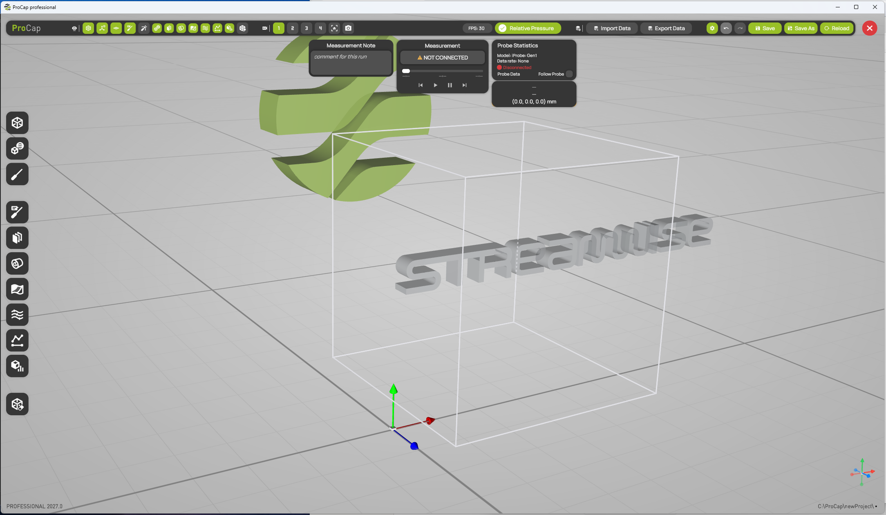

# Workspace overview

After you open a project on the [start screen](../projects/start-screen.md), ProCap shows the workspace. The 3D view fills the window. The display header runs along the top, the hotbar along the left edge, and the measurement controls sit at the top center. Settings panels open as floating windows over the 3D view.

<figure><figcaption>
The ProCap workspace
</figcaption></figure>

## Areas of the workspace

| Area | Where | What it contains |
| --- | --- | --- |
| [Display header](display-header.md) | Top | Toggles that show or hide each kind of element in the 3D view, the camera views, **Relative Pressure**, **Import Data** and **Export Data**, **General Settings**, undo and redo, **Save**, **Save As** and **Reload**, and the button that closes the project. |
| [Hotbar](hotbar-and-windows.md) | Left edge | One button per settings panel. The upper group sets up the scene, the middle group holds the visualization features, and the **Voxel Eraser** sits at the bottom. |
| Measurement controls | Top center | **Measurement Note**, the **Measurement** panel, **Probe Statistics** and the probe data card. |
| 3D view | Center | The measurement domain, the models, the probe and all visualizations. |
| Status line | Bottom | Your edition and version on the left, the project folder on the right. |

## Display header

The display header holds the commands you use across the whole project. See [Display header](display-header.md) for each button.

* **Show and hide.** Each toggle shows or hides one kind of element in the 3D view, for example the domain, the [ground plane](../scene-setup/measurement-domain-and-interpolation.md#groundplane-settings), the [current state](../visualization/current-state.md), the models or the visualization planes. For the elements you manage in a panel, a right click opens that panel.
* **Camera views.** The buttons **1** to **4** store and recall camera positions. See [Camera and navigation](camera-and-navigation.md).
* **Relative Pressure.** Shows pressures relative to the mean static pressure of the measured data. See [Quantities](../measurement/quantities.md).
* **Import Data** and **Export Data.** See [Import of measurement data](../data-processing/import-measurement-data.md) and [Data export](../measurement/data-export.md).
* **General Settings.** The cog opens the [General settings](general-settings.md).
* **Undo and redo.** Undo (Ctrl+Z) and redo (Ctrl+Y) changes to the project.
* **Save**, **Save As** and **Reload.** See [Save, Save As and Reload](save-and-reload.md).
* **Close project.** The red button closes the project and returns to the start screen. If the project has unsaved changes, ProCap asks whether to save them first.

## Hotbar

The hotbar on the left opens the settings panels. Each panel opens as a floating window that you can move. See [Hotbar and windows](hotbar-and-windows.md).

| Group | Panels |
| --- | --- |
| Setting up the scene | [Domain Settings](../scene-setup/measurement-domain-and-interpolation.md), [Models](../scene-setup/models.md), [Probe Settings](../scene-setup/probe-settings.md) |
| Visualization features | [Current state](../visualization/current-state.md), [Visualization planes](../visualization/visualization-planes.md), [Isosurfaces](../visualization/isosurfaces.md), [Projections](../visualization/projections.md), [Streamlines](../visualization/streamlines.md), [Lineplot](../visualization/lineplot.md), [Surface analytics](../visualization/surface-analytics.md) |
| Coverage | [Voxel Eraser](../visualization/voxel-eraser.md) |

Your edition shows only the panels it includes. See [Features and editions](../getting-started/features-and-editions.md).

## Measurement controls

| Element | Description |
| --- | --- |
| **Measurement Note** | A comment for the next measurement. ProCap saves it with the measurement in the list of measurements. See [Keeping track of the data](../measurement/keeping-track-of-the-data.md). |
| **Measurement** | Starts and stops a measurement, and controls the replay of recorded data with its time slider and play buttons. It shows **NOT CONNECTED** until a probe is connected. See [Recording a measurement](../measurement/recording-a-measurement.md) and [Measurement replay](../measurement/measurement-replay.md). |
| **Probe Statistics** | The connection state, data rate and model of the probe, and the **Follow Probe** option for the probe data card. See [Probe statistics](probe-statistics.md). |
| Probe data card | The current values of the probe as numbers and the position of the probe tip. See [Probe data card](probe-data-card.md). |

## 3D view

The 3D view shows the [measurement domain](../scene-setup/measurement-domain-and-interpolation.md) as a white box, the [models](../scene-setup/models.md), the probe and all visualizations.

* **Navigation.** Orbit, pan and zoom with the mouse. See [Camera and navigation](camera-and-navigation.md).
* **Coordinate system.** The colored axes show the origin and the directions of the coordinate system: red for X, green for Y and blue for Z. The small axes in the bottom-right corner show the orientation of the view. See [Coordinate system](coordinate-system.md).
* **Selecting and moving objects.** Click an object to select it, then move it with its gizmo or use its quick actions. See [Transform gizmos](gizmos.md).

## Status line

The status line at the bottom shows your edition and version on the left, for example **PROFESSIONAL 2027.0**, and the folder of the open project on the right. A dot (**•**) after the folder means that the project has unsaved changes.
