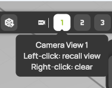

# Camera and navigation

You move the camera of the 3D view with the mouse. The view axes in the bottom-right corner snap the camera to fixed views. You can save up to four camera views per project and take screenshots of the workspace.

## Navigate with the mouse

| Action | Mouse or key |
| --- | --- |
| Orbit around the scene | Drag with the left mouse button. |
| Pan | Drag with the right mouse button. |
| Zoom | Turn the mouse wheel, or hold + or − on the numeric keypad. |

The camera orbits around the up axis of the scene, so the view never rolls. When the pointer is over a panel or a button, the mouse does not move the camera.

To move or edit an object instead of the camera, select it and use its gizmo. See [Transform gizmos](gizmos.md).

## Use the view axes

The view axes in the bottom-right corner of the 3D view show the orientation of the camera. Each axis has an arrow on its positive end and a dot on its negative end: red for X, green for Y and blue for Z.

* **Snap to a fixed view.** Click an end of an axis to look at the scene from that side.
* **Roll a fixed view.** Double-click an end to turn that view by a quarter turn. A double click with the left button and one with the right button turn in opposite directions. ProCap keeps the turned view for the next time you snap to that side.
* **Turn in one direction only.** When you move the pointer close to the view axes, two rings appear. Drag a ring to turn the camera around the up axis only, or to tilt it only. Hold Shift to turn in steps.

## Reset the camera

Select  in the display header. The camera returns to the default three-quarter view from above, framed on the measurement domain.

## Save and recall camera views

The buttons **1** to **4** in the display header are four slots for camera views. Each slot stores the camera position and the visibility of the models, visualization planes, isosurfaces, projections, streamlines and lineplots. A green slot holds a saved view.

<figure><figcaption>
The tooltip of a saved camera view
</figcaption></figure>

| To | Do this |
| --- | --- |
| Save the current view | Right-click an empty slot. |
| Recall a saved view | Left-click a saved slot. ProCap restores the camera and the visibility of the elements. |
| Clear a saved view | Right-click a saved slot. |

The tooltip of each slot shows whether it is empty and what each click does. The camera views are part of the project, so [save the project](save-and-reload.md) to keep them. Elements that you added after you saved a view keep their current visibility when you recall it.

## Take a screenshot

1. Set up the view you want to capture.
2. Select  in the display header. ProCap captures the whole workspace and shows a preview.
3. Enter a file name, or keep the suggested name `session_screenshot_<date>_<time>`.
4. Select **SAVE**.

ProCap saves the screenshot as a PNG file in the `Output/ScreenShots` folder of the project. If a file with the same name exists, ProCap adds a number to the new name, so no screenshot is overwritten. See [Project folder structure](../projects/project-folder.md).
