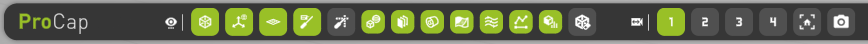
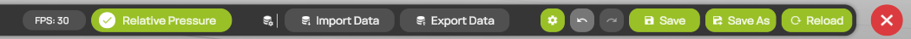

# Display header

The display header runs along the top of the [workspace](README.md). Its left part controls what the 3D view shows and holds the camera views. Its right part holds the project-wide commands: import and export, settings, undo and redo, saving and closing.

Hover over a button to see its name. A button that is not available, for example because the loaded data does not support the feature, is grayed out, and its tooltip tells you why.

## Visualization toggles

<figure><figcaption>
Visualization toggles and camera views
</figcaption></figure>

The  **Visualization Toggles** show or hide whole groups of elements in the 3D view. A green button means that the group is shown.

* **Left click** shows or hides the group.
* **Right click** opens the settings panel of the group, where there is one.

| Button | Name | What it shows or hides |
| --- | --- | --- |
|  | **Domain** | The outline of the [measurement domain](../scene-setup/measurement-domain-and-interpolation.md). A right click opens **Domain Settings**. |
|  | **Coordinate Origin** | The axes at the origin of the [coordinate system](coordinate-system.md). |
|  | **Ground Plane** | The [ground plane](../scene-setup/measurement-domain-and-interpolation.md#groundplane-settings). A right click opens **Domain Settings**, which holds the ground plane settings. |
|  | **Position Feedback** | White guide lines from the probe tip to the coordinate planes. They help you judge where the probe is in the domain. |
|  | **Current State** | The live reading at the probe tip. A right click opens **Current State Settings**. See [Current state](../visualization/current-state.md). |
|  | **Models** | All [models](../scene-setup/models.md). |
|  | **Visualization Planes** | All [visualization planes](../visualization/visualization-planes.md). |
|  | **Isosurfaces** | All [isosurfaces](../visualization/isosurfaces.md). |
|  | **Projections** | All [projections](../visualization/projections.md). |
|  | **Streamlines** | All [streamlines](../visualization/streamlines.md). |
|  | **Lineplot** | All [lineplots](../visualization/lineplot.md). |
|  | **Surface analytics** | All [surface analyses](../visualization/surface-analytics.md). |
|  | **Voxel Eraser** | The [voxel eraser](../visualization/voxel-eraser.md) cubes. A right click opens the **Voxel Eraser** panel. |

The group toggles from **Models** to **Surface analytics** do not change the visibility you set for each element in its panel. When you hide a group and show it again, ProCap shows only the elements that were visible before.

Your edition shows only the toggles for the features it includes. See [Features and editions](../getting-started/features-and-editions.md).

## Camera views

| Button | Name | Description |
| --- | --- | --- |
|  | **Camera Views** | Marks the camera group. |
| **1** to **4** | **Camera View 1** to **Camera View 4** | Four slots for camera views. A green slot holds a saved view. Right-click an empty slot to save the current view, left-click a saved slot to recall it, and right-click a saved slot to clear it. |
|  | Reset camera | Returns the camera to the default view of the domain. |
|  | Screenshot | Takes a screenshot of the workspace. |

See [Camera and navigation](camera-and-navigation.md).

## Project commands

<figure><figcaption>
Project commands
</figcaption></figure>

| Button | Name | Description |
| --- | --- | --- |
| **FPS** | Frame rate | The current frame rate of the 3D view, in frames per second. |
| **Relative Pressure** | Relative Pressure | When checked, ProCap shows pressures relative to the mean static pressure of the measured data instead of absolute values. This applies to the visualizations, the current state and the lineplots. |
|  | **Import Data** | Opens a file dialog to select recorded measurement data. See [Import of measurement data](../data-processing/import-measurement-data.md). |
|  | **Export Data** | Opens the **DATA EXPORT** dialog. See [Data export](../measurement/data-export.md). |
|  | **General Settings** | Opens the [General settings](general-settings.md). |
|  | **Undo** | Undoes the last change to the project (Ctrl+Z). The tooltip names the change. |
|  | **Redo** | Redoes the last change you undid (Ctrl+Y). |
|  | **Save** | Saves the project. Ctrl+S saves directly. See [Save, Save As and Reload](save-and-reload.md#save). |
|  | **Save As** | Saves a copy of the project to another folder. See [Save As](save-and-reload.md#save-as). |
|  | **Reload** | Reloads the project as it was last saved. See [Reload](save-and-reload.md#reload). |
|  | Close project | Closes the project and returns to the [start screen](../projects/start-screen.md). If the project has unsaved changes, ProCap asks whether to save them first. |
