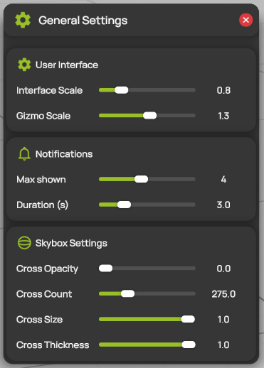

# General settings

The general settings control how ProCap looks on your computer. They apply immediately, belong to the computer rather than to the project, and stay the same when you open another project.

## Change the general settings

1. Select  **General Settings** in the [display header](display-header.md).
2. Move the sliders. ProCap applies each change immediately.
3. Close the panel with the red button.

<figure><figcaption>
General Settings
</figcaption></figure>

## User Interface

| Setting | Description |
| --- | --- |
| **Interface Scale** | The size of the panels, buttons and text, from 0.5 to 2. Increase it on a high-resolution screen or for a presentation. ProCap applies the new size when you release the slider. |
| **Gizmo Scale** | The size of the [gizmos](gizmos.md) and the other controls in the 3D view, from 0.5 to 2. |

## Notifications

| Setting | Description |
| --- | --- |
| **Max shown** | The largest number of notifications that ProCap shows at the same time, from 1 to 8. See [Warnings and notices](warnings-and-notices.md). |
| **Duration (s)** | How long each notification stays on the screen, from 1 to 10 seconds. |

## Skybox Settings

The background of the 3D view shows small reference crosses. When you orbit the camera, they move with the view and help you keep your orientation.

| Setting | Description |
| --- | --- |
| **Cross Opacity** | How strongly the crosses show. At 0, they are hidden. |
| **Cross Count** | The number of crosses. |
| **Cross Size** | The size of the crosses. |
| **Cross Thickness** | The line thickness of the crosses. |
