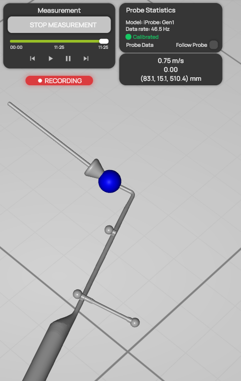
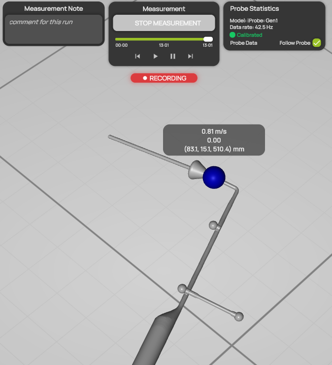

# Probe data card

The probe data card shows the current values of the probe as numbers. It sits below [Probe Statistics](probe-statistics.md) in the measurement controls. If you want, it can follow the probe tip in the 3D view, so you can read the values while you watch the probe.

## What the card shows

| Line | Description |
| --- | --- |
| Velocity | The magnitude of the flow velocity, in m/s. |
| Scalar value | The value of the scalar quantity selected under **Quantity** in the [Current state](../visualization/current-state.md) settings, with its unit, for example the static pressure in Pa. |
| Position | The position of the probe tip in the [coordinate system](coordinate-system.md), as (x, y, z) in mm. |

The card shows the live values while you measure, and the replayed values during a [measurement replay](../measurement/measurement-replay.md). While the probe is connected but no data is recorded yet, the velocity and the scalar value show a dash (**—**).

<figure><figcaption>
The probe data card in its place below Probe Statistics
</figcaption></figure>

## Follow the probe tip

1. In [Probe Statistics](probe-statistics.md), check **Follow Probe**.
2. The card moves to the probe tip in the 3D view and follows the probe as it moves. Its background becomes partly transparent, so you can still see the scene behind it.
3. To put the card back, clear **Follow Probe**.

<figure><figcaption>
The probe data card following the probe tip
</figcaption></figure>

The card follows the probe only while the probe is shown in the 3D view. If the tracking system loses the probe for more than two seconds, or the probe is behind the camera, the card returns to its place. It follows the probe again as soon as the probe is visible.
