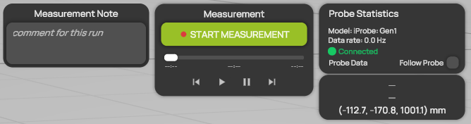

# Probe statistics

**Probe Statistics** at the top right of the measurement controls shows whether the probe is connected and how fast it delivers data. Check it before and during a measurement.

<figure><figcaption>
Probe Statistics with a connected probe
</figcaption></figure>

| Line | Description |
| --- | --- |
| **Model** | The probe model selected in [Probe settings](../scene-setup/probe-settings.md), for example **iProbe: Gen1**. |
| **Data rate** | The rate at which ProCap receives data from the probe, in Hz. It shows **None** while no probe is connected. If the connection drops, the line also shows that ProCap is reconnecting, and how many data frames were lost. |
| Connection state | The state of the probe connection, with a colored dot. See the table below. |
| **Place probe in camera view...** | A warning that appears while the tracking system does not see the probe. Move the probe into the field of view of the cameras. |
| **Follow Probe** | Moves the [probe data card](probe-data-card.md) below to the probe tip in the 3D view. |

Probe Statistics is not shown in Professional Reader, which cannot measure.

## Connection states

| State | Meaning |
| --- | --- |
| **Disconnected** | No probe is connected. Connect it in **Probe Settings**. |
| **Connecting...** | ProCap is establishing the connection. |
| **Connected** | The probe is connected and delivers data. You can start a measurement. |
| **Calibrating...** | The probe is correcting its zero offset. |
| **Calibrated** | The probe is connected and its zero offset is corrected. |

See [Connecting a probe](../measurement/connecting-a-probe.md) and [Recording a measurement](../measurement/recording-a-measurement.md).
