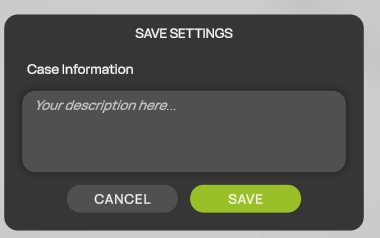
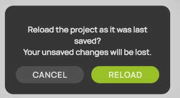

# Save, Save As and Reload

ProCap keeps your changes to the project in memory until you save them. While the project has unsaved changes, the status line at the bottom of the workspace shows a dot (**•**) after the project folder.

The three commands are on the right of the [display header](display-header.md).

| Button | Command | Description |
| --- | --- | --- |
|  | **Save** | Saves the project to its project file. |
|  | **Save As** | Saves a copy of the whole project to another folder and continues there. |
|  | **Reload** | Discards the unsaved changes and loads the project as it was last saved. |

## Save

1. Select  **Save** in the display header. The **SAVE SETTINGS** dialog opens.
2. Optional: under **Case Information**, enter or edit a description of the project, for example the test object, the configuration or the flow conditions.
3. Select **SAVE**.

<figure><figcaption>
SAVE SETTINGS
</figcaption></figure>

ProCap saves all settings to the project file `configFile.proCap` in the `Input` folder. The first time you save during a session, ProCap keeps the previous project file as a backup. See [Project folder structure](../projects/project-folder.md).


To save without the dialog, press Ctrl+S. The case information stays as it is.


## Save As

Use **Save As** to save the project under a new folder, for example to start a variant of a test without changing the original project.

1. Select  **Save As** in the display header. A folder dialog opens.
2. Select or create an empty folder.
3. Confirm the dialog.

ProCap copies the whole project to the new folder, including the `Input` and `Output` folders with all measurements, and saves the current settings there. ProCap then continues with the copy. The original project keeps its last saved state.

* If the folder already contains a ProCap project, ProCap does not save. Choose an empty folder.
* If the folder contains other project files, ProCap asks whether to overwrite them.
* If you select the folder of the current project, ProCap saves the project in place.
* Stop a running measurement before you use **Save As**.

## Reload

Use **Reload** to discard your changes and return to the last saved state of the project.

1. Select  **Reload** in the display header.
2. ProCap asks you to confirm. If the project has unsaved changes, the question warns that they will be lost. Select **RELOAD** to continue, or **CANCEL** to keep working.

<figure><figcaption>
Confirm the reload
</figcaption></figure>

ProCap disconnects the probe and the tracking system, then loads the project file from disk again. Reload does not save anything.
